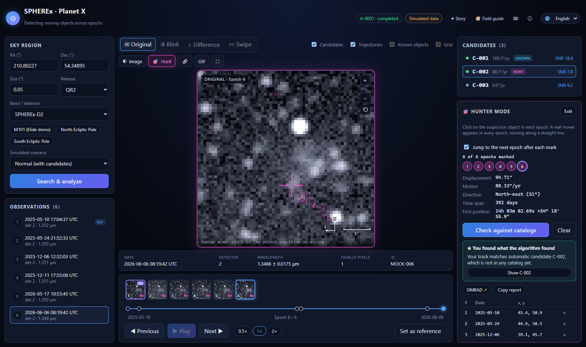
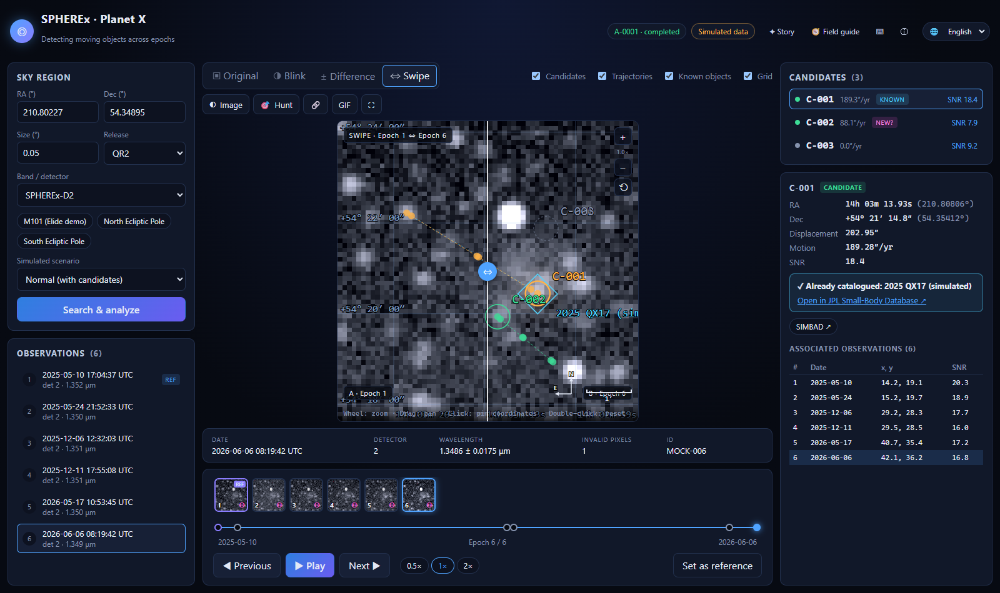
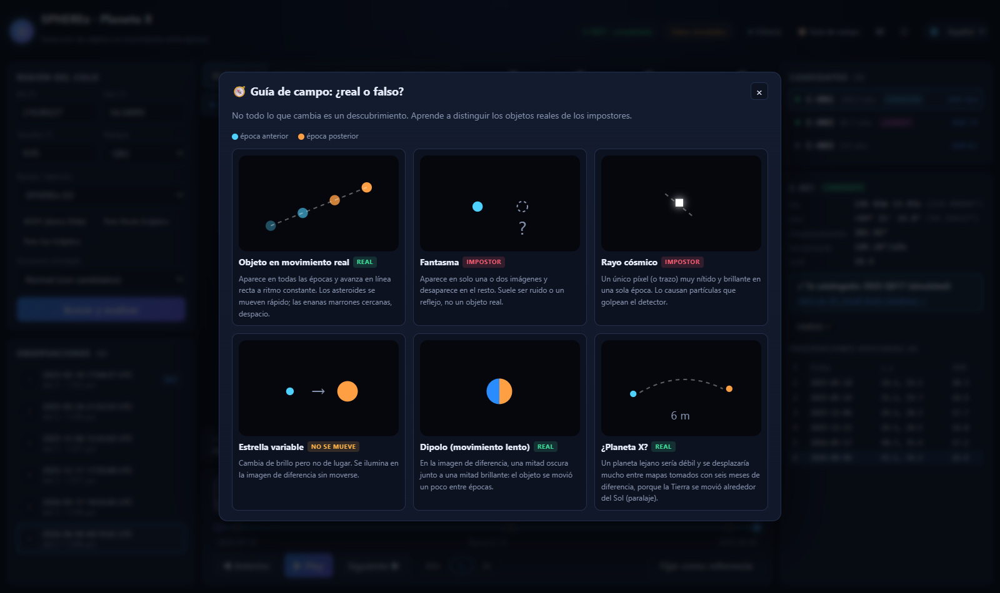

# Andy — Frontend / Visualization

**Programador:** Andy

**Responsabilidad**

Construir la interfaz para explorar observaciones SPHEREx y resultados del análisis.

**Tareas**

1. Crear interfaz web principal.
2. Permitir ingresar o seleccionar:
   - RA;
   - Dec;
   - tamaño de región.
3. Consumir inicialmente datos mock.
4. Consumir posteriormente la API real.
5. Crear visor de la región observada.
6. Mostrar las observaciones disponibles ordenadas temporalmente.
7. Implementar:
   - cambio manual entre épocas;
   - timeline;
   - Play/Pause;
   - Blink Mode;
   - Difference Mode.
8. Implementar zoom y desplazamiento del visor.
9. Mostrar fecha, detector y longitud de onda de la observación activa.
10. Dibujar candidatos sobre las imágenes.
11. Permitir seleccionar un candidato.
12. Mostrar para cada candidato:
    - RA;
    - Dec;
    - desplazamiento;
    - movimiento;
    - SNR;
    - observaciones asociadas.
13. Mostrar visualmente la trayectoria del candidato entre épocas.
14. Manejar estados:
    - sin resultados;
    - cargando;
    - procesando;
    - error;
    - análisis completado.
15. Adaptar la interfaz a desktop para la demostración.

**Pantalla principal mínima**

```text
RA / DEC / Search

        SKY VIEW

Epoch: [----------------●------]

Previous | Play | Next
Blink | Difference | Original

Candidates
- C-001
- C-002

Candidate details
RA
DEC
Motion
SNR
```

**Entregables**

- frontend funcional;
- visor de observaciones;
- timeline;
- blink mode;
- difference mode;
- overlays de candidatos;
- integración final con API.

---

## Estado actual: maqueta funcional con datos simulados





La app (Vite + React + TypeScript) ya implementa todas las tareas de la tarjeta
usando un **cielo sintético generado en el navegador**: no se usan datos reales.
El mock imita lo que devolverá el backend (6 épocas, cuadrícula 64×64 px a
6.2″/px como el demo de Elide, 2 objetos en movimiento, 1 artefacto y un
asteroide «conocido» simulado que coincide con C-001).

### Funciones extra (inspiradas en WiseView, Backyard Worlds, Legacy Survey y Aladin)

- **Modo cazador** (`H`): el usuario marca el objeto en cada época; se calcula
  desplazamiento, ″/año y dirección, y «Comprobar en catálogos» lo compara con
  objetos conocidos y con los candidatos del algoritmo (veredicto: conocido,
  coincide con el algoritmo o posible descubrimiento). Incluye aviso de
  «fantasma» y reporte JSON copiable.
- **Modo deslizador** (`S`) para comparar referencia vs. época activa.
- **Ajustes de imagen**: stretch (lineal, raíz, log, asinh), mapas de color
  (incluido uno apto para daltonismo), brillo, contraste e invertir.
- **Visor**: brújula N/E, barra de escala, rejilla RA/Dec (`G`), objetos
  conocidos (`K`), clic para fijar y copiar coordenadas, enlaces a SIMBAD y JPL SBDB.
- **Tira de miniaturas**, velocidad de reproducción 0.5×/1×/2×, pantalla completa (`F`).
- **Enlace compartible**: la vista (región, modo, época, candidato) vive en la URL.
- **Exportar GIF** del parpadeo/diferencias (librería `gifenc`).
- **Intro narrativa** (Plutón 1930 → SPHEREx), **guía de campo** real vs. impostor,
  **ayuda de atajos** (`?`) y **créditos** con el agradecimiento de IRSA y los DOI de QR2/QR3.
- Accesibilidad: respeta `prefers-reduced-motion` y avisa de fotosensibilidad en el parpadeo.
- **Responsive**: escritorio (3 columnas), tablet (≤1279 px, 2 columnas con
  candidatos debajo) y teléfono (≤860 px, una columna con el visor tras la
  búsqueda). En pantallas táctiles: pellizcar para zoom, arrastrar para mover
  y tocar para fijar coordenadas o marcar en modo cazador.



### Ejecutar

```bash
cd frontend_visualization_andy
npm install
npm run dev      # http://localhost:5173
npm run build    # typecheck + build de producción
```

Atajos: `←` / `→` cambiar época, `Espacio` play/pausa, `O` / `B` / `D` / `S`
modos, `H` cazador, `G` rejilla, `K` conocidos, `F` pantalla completa, `?` ayuda.
En modo mock hay un selector «Escenario simulado» para probar los estados
procesando lento, sin resultados y error.

### Idiomas (i18n)

La interfaz está en **inglés (principal)** y **español**, con un selector 🌐
en la barra superior. El idioma elegido se guarda en `localStorage`.

Cada idioma es un archivo en `src/i18n/locales/`. `en.ts` es la base y define
las claves; los demás se tipan como `Messages`, así que TypeScript marca error
si falta o sobra alguna clave. Para añadir, por ejemplo, portugués:

1. Copiar `src/i18n/locales/es.ts` a `pt.ts` y traducir los valores
   (incluido `meta.name: 'Português'` y `meta.htmlLang: 'pt'`).
2. Registrarlo en `src/i18n/index.ts`:

```ts
import pt from './locales/pt'
export const LOCALES = { en, es, pt } satisfies Record<string, Messages>
```

En componentes se usa `const { t } = useI18n()` y `t('candidates.title')`;
los parámetros van con llaves: `t('timeline.epochOf', { n: 2, total: 6 })`.
Fuera de React (API, mock) se usa `translate(...)` de `src/i18n`.

### Pasar a la API real

Copiar `.env.example` a `.env.local` y poner:

```text
VITE_API_MODE=http
VITE_API_URL=http://localhost:8000
```

No hay que tocar componentes: todo pasa por la interfaz `SpherexApi`
(`src/api/types.ts`), con dos implementaciones, `mockApi.ts` y `httpApi.ts`.

### Estructura

```text
src/
  types/contracts.ts     contratos compartidos (Observation, Candidate, imágenes…)
  i18n/                  traducciones (locales/en.ts, locales/es.ts) + useI18n
  api/                   SpherexApi + mock + cliente HTTP
  mock/syntheticSky.ts   generador del cielo sintético (solo para la maqueta)
  hooks/useAnalysis.ts   ciclo pending → processing → completed / error (polling)
  components/            SkyViewer, Timeline, SearchPanel, CandidatePanel…
```

## Contrato que el front espera del backend (para Anghelo)

Tipos exactos en `src/types/contracts.ts`.

| Endpoint | Respuesta |
| --- | --- |
| `POST /analysis` body `{ra, dec, size, qr, bandpass}` | `AnalysisInfo` |
| `GET /analysis/{id}` | `AnalysisInfo` (el front hace polling cada 600 ms) |
| `GET /analysis/{id}/observations` | `ObservationSummary[]` = `Observation.to_summary()` de Elide, en orden cronológico |
| `GET /analysis/{id}/candidates` | `Candidate[]` |
| `GET /analysis/{id}/images` | `AnalysisImages` |
| `GET /analysis/{id}/known-objects` *(propuesto, opcional)* | `KnownObject[]`; si devuelve 404 el front lo trata como lista vacía |

```json
// AnalysisInfo
{ "id": "A-0001", "status": "pending|processing|completed|error",
  "region": {"ra": 210.80227, "dec": 54.34895, "size": 0.05, "qr": "qr2", "bandpass": "SPHEREx-D2"},
  "createdAt": "2026-09-30T12:00:00Z", "progress": 0.4, "message": "…", "error": null }

// Candidate (x, y = píxel en la cuadrícula común del análisis, origen arriba-izquierda)
{ "id": "C-001", "ra": 210.80806, "dec": 54.35412,
  "displacementArcsec": 202.95, "motionArcsecPerYear": 189.28, "snr": 18.4, "status": "candidate",
  "detections": [{ "observationId": "…", "timestamp": "…", "ra": 0, "dec": 0, "x": 14.2, "y": 19.1, "snr": 20.3 }] }

// AnalysisImages
{ "width": 64, "height": 64, "pixelScaleArcsec": 6.2,
  "epochs":      [{ "observationId": "…", "url": "/files/A-0001/epoch_001.png" }],
  "differences": [{ "observationId": "…", "referenceId": "…", "url": "/files/A-0001/diff_002.png" }] }

// KnownObject (p. ej. desde SkyBoT o IRSA MOST, posiciones en la misma cuadrícula)
{ "name": "2025 QX17", "type": "asteroid|comet|planet|satellite", "magnitude": 17.8,
  "positions": [{ "observationId": "…", "ra": 0, "dec": 0, "x": 14.0, "y": 19.3 }] }
```

Notas sobre las «imágenes»:

- El front **no lee FITS**: necesita PNG ya renderizados (stretch asinh o
  similar) de cada época, todos del mismo tamaño y alineados a la misma
  cuadrícula WCS (lo que produce Etner al reproyectar).
- Las diferencias se generan en el backend (Etner) y se sirven como PNG con
  mapa de color divergente.
- Las URLs pueden ser relativas (el front les antepone `VITE_API_URL`),
  absolutas o `data:`.
- `status` de candidato: `candidate | confirmed | rejected | artifact`.
- Los ajustes de imagen y el GIF leen los píxeles en un `<canvas>`: si las
  imágenes se sirven desde otro origen, el backend debe enviar
  `Access-Control-Allow-Origin` (CORS). Sin CORS el visor sigue mostrando las
  imágenes originales, pero los ajustes de stretch/color no se aplican y el
  GIF no se puede generar.
